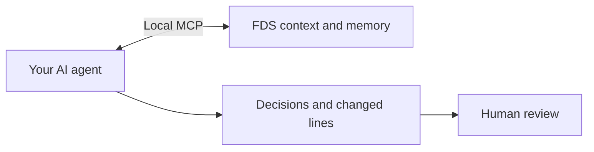

# FDS for agents and AI

FDS stores context and agent memory in portable `.fds` files. Agents retrieve
records through MCP and leave decisions and file references for human review.
FDS returns stored information with its source and retrieval confidence.



Experimental software, Apache-2.0. Retrieval is lexical. Verification labels
are metadata, not proof of identity. Use OS permissions to protect files.

## Build and test

```sh
cargo build --release -p fds-cli
cargo test --workspace
```

The binary is `target/release/fds` (`fds.exe` on Windows). No Python, external
model, embedding service or web server is required.

## Start

```sh
fds init project
fds --db project.fds fact add "What is the service port?" "443" --source project-spec
fds --db project.fds add docs/
fds --read-only --db project.fds query "service port"
```

## MCP

Configure the host to run FDS with an absolute database path:

```json
{"mcpServers":{"fds":{"command":"fds","args":["--db","/absolute/path/project.fds","mcp","--write","--as","coding-agent"]}}}
```

Without `--write`, MCP only reads. `--read-only` also refuses writes. Agent
memory is marked `model:<name>` and cannot replace person-verified facts.
For several agents, sectors separate writable memory from shared context.

## Record and review

```sh
fds --db project.fds log "Updated order validation" --by backend --why "Reject duplicate items" --file backend/server.js:42-58
fds --db project.fds journal show
fds --db project.fds review --list
fds --db project.fds journal review RECORD_ID
```

Agents propose and document; a person reviews. Review labels do not authenticate
who ran the command. FDS does not guarantee that agents obey instructions.

## Repository

- `crates/fds-core/`: file format, checksums and atomic writes.
- `crates/fds-cli/`: CLI, context, memory, local MCP and human review.
- `docs/`: [guide](docs/GUIDE.md), specification and Rust conformance fixtures.
- `examples/`: sample databases and source data.
- [FDS.md](FDS.md): instructions for coding agents.

This basic distribution removes HTTP hosting, browser management, embeddings,
vision, policy enforcement, guard and audit commands. Existing file versions
remain readable; the CLI surface has intentionally changed.
